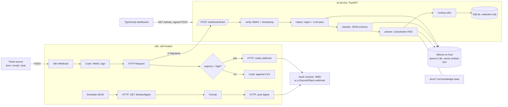

# ai-ops-automation

AI-powered support-ticket triage that runs entirely on free, local, open-source tools: a reusable **FastAPI AI service** (PII redaction, classification, **LlamaIndex** RAG), **n8n** workflows that call it through **signed webhooks**, a typed **TypeScript** dashboard, and an eval harness. No paid APIs and no cloud: the LLM is **Ollama** (`qwen2.5:3b` + `nomic-embed-text`) through its OpenAI-compatible endpoint.

## Architecture



PII is redacted **before** anything else sees the ticket: the classifier, the RAG query, the logs, the database and n8n only get redacted text.

## Endpoints (ai-service)

| Method | Path | What it does |
|---|---|---|
| POST | `/classify` | `{text}` -> `{category, urgency, sentiment}` via JSON-schema structured output |
| POST | `/redact` | `{text}` -> redacted text + spans. Regex (email, phone, Luhn-checked card, SSN, street address) + a small-LLM pass for names/addresses. The LLM only proposes substrings, and only exact matches get replaced, so it cannot rewrite text. `?llm_pass=false` for regex only |
| POST | `/answer` | `{question, top_k}` -> answer + sources (LlamaIndex `VectorStoreIndex` over `docs/`) |
| POST | `/webhook/ticket` | Verifies `X-Signature: sha256=HMAC(secret, "<X-Timestamp>.<body>")` (5-minute replay window), then redact -> classify -> answer -> route (`escalate` / `auto_reply` / `queue`) |
| GET | `/tickets`, `/tickets/digest` | Processed tickets and an aggregate for the daily digest |
| GET | `/health` | Liveness |

Every response carries `X-Request-ID` (taken from the request or generated). Logs are one JSON object per line, tagged with the request ID.

## Run it locally (no Docker)

```bash
ollama pull qwen2.5:3b && ollama pull nomic-embed-text
python -m venv .venv && .venv/Scripts/activate        # Windows Git Bash; use bin/activate on Linux/macOS
pip install -r services/ai-service/requirements.txt

cd services/ai-service && uvicorn app.main:get_app --factory --port 8000   # API docs: http://localhost:8000/docs
python mock-receiver/server.py 9000                                         # separate terminal
cd web && npm install && npm run dev                                        # http://localhost:5173
python scripts/smoke.py                                                     # 2 signed tickets in-process
```

Config is set through env vars: `LLM_BASE_URL` (default `http://localhost:11434/v1`), `LLM_MODEL`, `EMBED_MODEL`, `WEBHOOK_SECRET`, `DOCS_DIR`, `DB_PATH`, `LLM_REDACT_PASS=0|1`. The dashboard reads `VITE_API_URL` and `VITE_WEBHOOK_SECRET`. Signing in the browser is a demo shortcut only; in production, n8n or a backend signs the request.

## Run with n8n (Docker)

```bash
docker compose up --build          # n8n :5678, ai-service :8000, mock receiver :9000; Ollama stays on the host
```

**Import the workflows:** open http://localhost:5678 and create the owner account. Then go to **Workflows -> Import from File** and pick `workflows/01-ticket-triage.json`, then `workflows/02-daily-digest.json`. You can also import from the CLI:

```bash
docker compose exec n8n n8n import:workflow --input=/workflows/01-ticket-triage.json
docker compose exec n8n n8n import:workflow --input=/workflows/02-daily-digest.json
```

Activate them, then send a test ticket:

```bash
curl -X POST http://localhost:5678/webhook/ticket-in -H 'Content-Type: application/json' \
  -d '{"ticket_id":"demo-1","subject":"Outage","body":"Everything is down for our whole team!"}'
curl http://localhost:9000/received     # escalations and digests land here
```

Non-urgent tickets are appended to `data/n8n-files/tickets.csv`. To post to a real channel, set `NOTIFY_WEBHOOK_URL` to a Discord or Slack incoming-webhook URL. The workflows read `AI_SERVICE_URL`, `NOTIFY_WEBHOOK_URL` and `WEBHOOK_SECRET` from the environment, and the Code nodes need `NODE_FUNCTION_ALLOW_BUILTIN=crypto,fs`. `docker-compose.yml` sets all of these. n8n image: `docker.n8n.io/n8nio/n8n:1.88.0`.

## Tests

```bash
cd services/ai-service && pytest -q     # fake LLM + LlamaIndex MockLLM/MockEmbedding, no Ollama needed
cd web && npm run build && npm test     # tsc strict + vite build + vitest
```

Covered: the redaction patterns, the Luhn check, LLM-pass safety (it cannot invent or rewrite text) and the fallback when the LLM is down; HMAC verification (wrong secret, tampered body, replay, missing headers); the routing rules; every endpoint, including a check that raw PII never reaches the store or the classifier; the real LlamaIndex index and query path; and the TS client, including signature parity with Node's `crypto`.

## Evaluation

`evals/generate.py` builds 40 labelled synthetic tickets from a fixed seed (category, urgency, `contains_pii` plus the exact planted strings, and the expected KB fact). All personal data in them is fake. `evals/run_eval.py` runs them through the real pipeline:

```bash
python evals/generate.py && python evals/run_eval.py              # all 40
python evals/run_eval.py --limit 12 --thresholds evals/thresholds-ci.json
```

| Metric | Value |
|---|---|
| Category accuracy / macro-F1 | TBD |
| Urgency accuracy / macro-F1 | TBD |
| PII redaction recall / precision | TBD |
| RAG fact hit / source hit / lexical groundedness | TBD |
| `/webhook/ticket` latency p50 / p95 (local CPU/GPU, qwen2.5:3b) | TBD |

CI (`.github/workflows/ci.yml`) runs pytest, the TS build and vitest, and an eval job that installs Ollama on the runner, pulls both models and gates on `evals/thresholds-ci.json`. Those thresholds are placeholders (0.0) until a baseline is measured.

## Limitations

- Name and address detection depends on a 3B local model. The regex layer handles the structured identifiers (email, phone, card, SSN, US-style street addresses) deterministically, but names are only caught by the LLM pass, so recall on names is model-dependent. Non-US formats are not covered.
- Groundedness is measured with simple checks (expected fact substring, expected source file, lexical overlap), not with an LLM judge.
- The vector index is in memory and rebuilt on first use; there is no persistent vector store yet.
- On a laptop CPU/GPU, a ticket takes tens of seconds (it makes 3-4 LLM calls). There is no queue or worker yet; the webhook processes synchronously.
- The knowledge base and tickets are synthetic and belong to a fictional company.
- The n8n workflow JSON was written by hand against n8n 1.x node schemas. Re-export it from the n8n UI after the first import.
